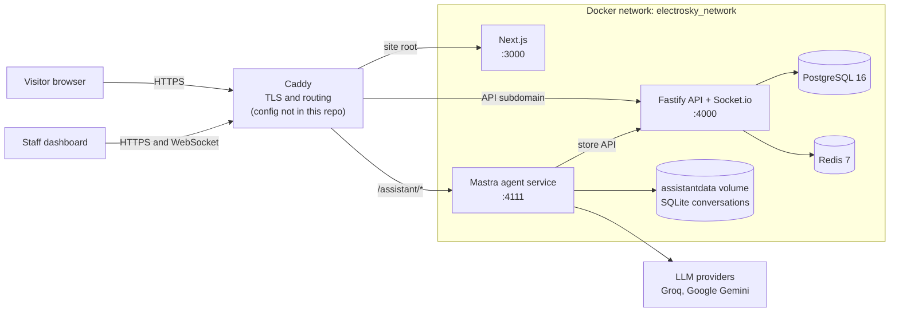

# Electro Sky Infrastructure

Electro Sky is an electronics e-commerce site that runs on a single VPS with Docker Compose. This repo holds its container configuration: a Next.js storefront and dashboard, a Fastify API, PostgreSQL 16, Redis 7, and a Mastra AI shop assistant, with Caddy in front as the reverse proxy. Application source lives in a separate repo, so this one is a sanitized reference for how the stack is put together. It does not run on its own (see [Known gaps and next steps](#known-gaps-and-next-steps)).

## Architecture



None of the five Compose services publish a host port. Traffic reaches them only through Caddy, which runs in a separate Compose project and is attached to `electrosky_network` by hand. Redis has its `default` user disabled, and its `app` user needs a password and cannot run `@dangerous` commands. The assistant receives only the variables listed under its `environment:` key, not the whole `.env`, so it holds no database or JWT secrets.

| Service | Image or build | Port | Persistent data |
|---|---|---|---|
| `postgres` | `postgres:16-alpine` | internal | `pgdata` |
| `redis` | `redis:7-alpine` | internal | `redisdata` |
| `backend` | `backend/Dockerfile` (Node 20) | 4000 | none |
| `frontend` | `frontend/Dockerfile` (Node 20, Next.js standalone) | 3000 | none |
| `assistant` | `assistant/Dockerfile` (Node 22) | 4111 | `assistantdata` |

## How deploy works

Deploys are manual. There is no CI/CD pipeline.

1. Push to the application repo.
2. On the server, run `git pull`.
3. Rebuild whatever changed, for example `docker compose build --no-cache backend`.
4. Run `docker compose up -d`.
5. If the database schema changed, run `docker compose exec backend npx prisma migrate deploy`. Migrations do not run on container start.

`NEXT_PUBLIC_*` values are baked into the frontend at build time, so changing one means rebuilding the frontend.

## Backups and restarts

**Backups:** there are no backup scripts in this repo, and no automated backup is confirmed. The only documented procedure is a manual Postgres dump and restore:

```bash
docker compose exec postgres pg_dump -U <user> <db> > backup_$(date +%Y%m%d).sql
docker compose exec -T postgres psql -U <user> <db> < backup.sql
```

Nothing documented covers the `redisdata` or `assistantdata` volumes. Assistant conversations are short-lived by design, with a default retention of 2 days.

**Restarts:** every service uses `restart: unless-stopped`, so containers come back after a crash or reboot. `postgres`, `redis` and `assistant` have health checks, and `backend` waits for Postgres and Redis to be healthy before it starts. `backend` and `frontend` have no health check. Docker's restart policy reacts to a process exit, not to an `unhealthy` status, so a hung container is not restarted automatically.

After a Caddy recreate or a `docker compose down`, Caddy has to be reattached to the project network, because that link is made manually.

## Problems solved

The code for these features is in the application repo. The paths below refer to that repo.

**LLM provider fallback.** The assistant is configured with an ordered two-model chain (`assistant/src/mastra/agents/shop-assistant.ts`). The primary model gets no retries, and a 12-second first-chunk timeout moves on when a provider accepts a request but never starts answering, so a visitor is not left waiting on a backoff. `docker-compose.yml` sets Groq (`groq/openai/gpt-oss-120b`) as primary and Gemini (`google/gemini-flash-latest`) as fallback. The order is set by environment variables, and the defaults in `config.ts` are the reverse, so Compose decides it in deployment.

**Rate limiting.** There are two layers:

- **Backend:** `@fastify/rate-limit` backed by Redis allows 100 requests per minute per IP globally, with tighter per-route limits. Some auth routes go as low as 3 requests per 15 minutes.
- **Assistant:** in-memory fixed-window counters allow 20 messages per hour per visitor session, 60 per hour per IP, and 1000 per day across the store, which also caps LLM spend. Blocked requests get a 429 with `retry-after`. Counters reset when the container restarts, which is acceptable for abuse protection in a single-container service.

**Real-time alerts.** When an order is created or changes status, the backend emits `new_order` or `order_status_changed` to a Socket.io `orders_room`. The socket handshake verifies the JWT from the `access_token` cookie and only admits admins and cashiers with the `orders` permission. The dashboard then plays a notification sound for new orders and refreshes the order views.

## Known gaps and next steps

- **No Caddyfile.** It lives only on the server and was never in the application repo. The routes in the diagram come from the project's deployment notes, not from a file here.
- **Not runnable alone.** Compose builds from `./backend`, `./frontend` and `./assistant`, and this repo contains only the Dockerfiles from those folders.
- **Model order on the server is unverified.** Production `.env` could override `ASSISTANT_MODEL_PRIMARY`. The fallback description above reflects the Compose defaults.
- **`docker-compose.dev.yml` publishes no ports.** Its comments mention `localhost:3000` and `localhost:4000`, but neither Compose file maps them, so those URLs would not work as written.
- **One change from production.** `POSTGRES_PASSWORD` is now required. In the original file it fell back to a hardcoded default.
- Next: automated nightly pg_dump to off-server storage.

## Configuration

Copy `.env.example` to `.env` and fill in the values. Real `.env` files are ignored by git.
